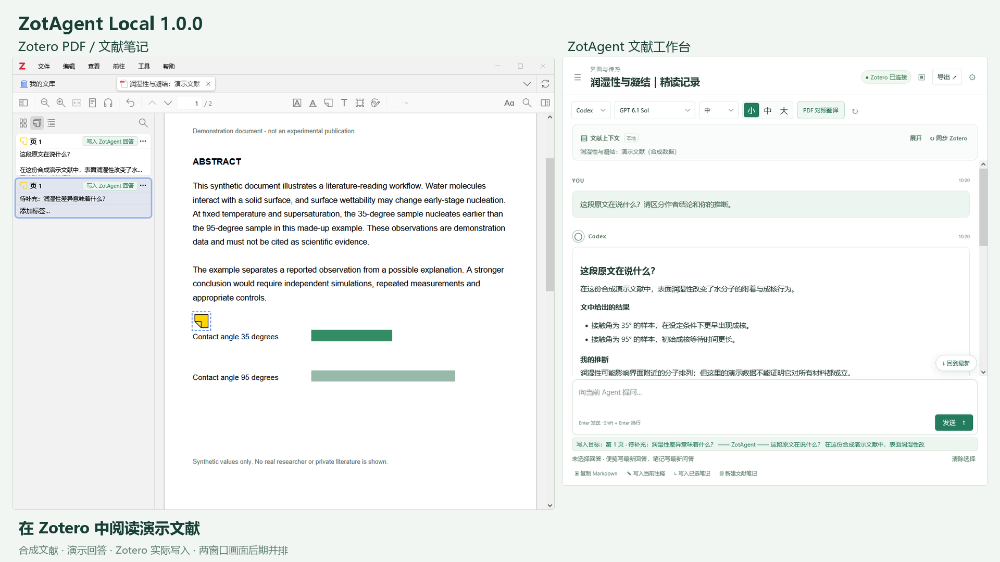
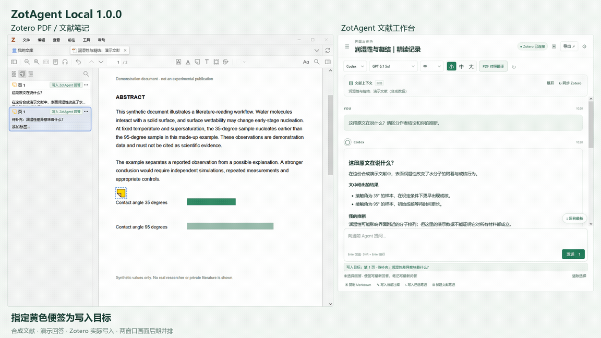
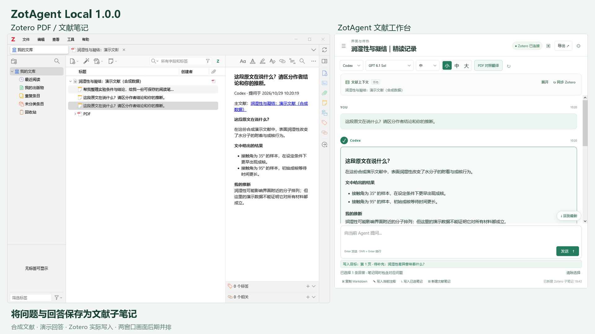
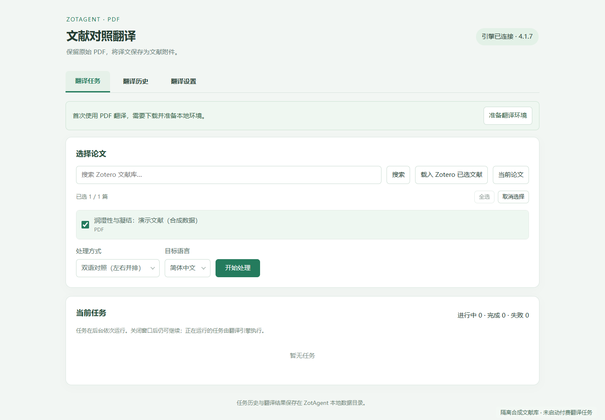

# ZotAgent Local 📚

### 在 Zotero 里读论文、问问题，把理解留在笔记里。

面向 **Windows x64** 的 Zotero 文献工作台。连接你自己的 Codex 账号，把 PDF 选区、全文、截图与多篇文献带入对话，再将回答写回 PDF 便签或文献笔记。

[下载插件](https://github.com/Decare1125/DE-1125/releases) · [使用指南](docs/USER-GUIDE.md) · [常见问题](docs/TROUBLESHOOTING.md) · [隐私说明](docs/PRIVACY.md)



> 演示使用合成文献和预设回答；注释与笔记通过真实 Zotero 接口写入。Zotero 与工作台分别导出后并排展示，不代表模型速度、科研结论或翻译质量。

## ✨ 功能

| 使用场景 | 可以做什么 |
| --- | --- |
| 看不懂原文 | 带着 PDF 选区提问，梳理作者结论、支持证据与模型推断 |
| 图表公式难理解 | 加入 PDF 截图或附件，结合上下文讨论 |
| 对比多篇论文 | 添加已选文献，或搜索本地文献库后加入对话上下文 |
| 解释留在原处 | 选择回答，追加到指定 PDF 黄色便签 |
| 积累阅读笔记 | 问答写入已有笔记，或明确新建文献子笔记 |
| 整理阅读主题 | 项目归档、会话拖动移入移出、重命名与搜索 |
| 调整阅读体验 | 小 / 中 / 大三档字体，模型与思考强度选择 |
| 阅读对照译文 | 独立翻译窗口、任务进度、历史及停止操作 |



## 🚀 安装

1. 从 [Releases](https://github.com/Decare1125/DE-1125/releases) 下载 `zotagent-local-1.0.0.xpi`。源码 ZIP 不能作为插件安装。
2. Zotero **工具 → 插件 → 齿轮 → 从文件安装插件**，选择 XPI，重启 Zotero。
3. **工具 → ZotAgent Local · 文献阅读助手** 打开工作台。
4. 设置中点击 **登录或检查 Codex**，使用自己的账号完成浏览器登录；本机已有有效登录时可沿用。
5. 打开 PDF，点击 **同步 Zotero**，选择原文或导入全文，开始提问。

**每位用户使用自己的账号、权限与额度。** 安装包不包含开发者账号、密钥或个人文献，不附赠付费额度。账号授权需要用户本人完成，插件不能自动替用户登录。

Windows x64 安装包内置 Node.js、Codex CLI 和 uv，日常问答无需安装 WSL。首次翻译需点击 **准备翻译环境**，联网部署 Python 和翻译依赖；首次处理还可能下载排版模型与字体。耗时和磁盘占用取决于网络、依赖及文档。

### 兼容范围

- 已在 **Windows x64 + Zotero 10.0.3** 上进行隔离安装和功能检查。
- 插件声明支持 Zotero 7–10，其他版本尚未逐一验证；macOS、Linux、Windows ARM 未完成适配。
- 模型列表来自用户的 Codex 目录；显示名称不代表账号具有该模型权限。
- 思考强度为 **轻度、中、高、极高、ultra**，以模型实际支持档位为准。
- 当前通过手动安装 XPI 更新，尚未配置公开自动更新服务。

## 📝 注释与笔记

| 操作 | 无选择时 | 有选择时 |
| --- | --- | --- |
| 写入当前注释 | 最新一次回答 | 选中的回答，只追加回答 |
| 写入已选笔记 | 最新一次问题与回答 | 选中回答及其对应问题 |
| 新建文献笔记 | 最新一次问题与回答 | 选中回答及其对应问题 |

回答旁的小圆圈用于多选，“选择到此”用于范围选择。问题时间采用发出问题时的时间。没有目标笔记会提示选择或新建，不会因误触自动创建。

便签可通过 **双击 PDF 黄色便签**、便签菜单 **设为 ZotAgent 写入目标**，或便签标题处 **写入 ZotAgent 回答** 指定。这些入口由本插件提供；切换文献后请核对底部目标提示。



可下载 [合成演示文献](examples/demo-paper.pdf) 练习操作；数据仅作流程示范。

## 🌐 PDF 对照翻译

从字体按钮旁的翻译入口打开独立窗口，或文献列表右键 → **ZotAgent-PDF 翻译**。选择原始 PDF、处理方式与目标语言，然后开始任务。

- 提供译文、双语对照、裁剪及裁剪后拼接入口。
- 本机引擎负责解析和排版，翻译源负责译文；与聊天模型分别设置。
- 提供 Bing、Google、OpenAI、DeepSeek 和兼容服务等选项；付费服务需要自己的 API 密钥。
- 关闭窗口后后台任务可继续；停止任务请使用停止 / 取消按钮。停止不能撤销已发出的云请求或退回已有费用。
- 可将结果添加到原文献，并查看本地任务历史。

免费服务可能限流或要求验证，不能保证随时可用。Google 429 不等于 PDF 损坏；已由 BabelDOC 处理的文件可能被拒绝再次翻译，请选原始 PDF。扫描件、复杂公式、受保护文档及翻译准确性需逐份核对。



## 🔒 数据与你的账号

会话、项目、附件副本、运行环境及翻译结果保存在当前 Zotero 配置目录的 `zotagent-local` 下。工作目录可在界面查看和复制。“已保存”表示本地会话保存时间，不代表写入了 Zotero 笔记或完成云同步。

本机服务仅监听回环地址并使用随机令牌。发送的上下文会交给所选 Agent 或翻译服务。翻译密钥目前以明文保存在本机配置与引擎配置中，勿分享配置目录或含密钥日志。详见 [隐私说明](docs/PRIVACY.md)。

## 🛠️ 开发与测试

需要 Python 3.12+、Node.js 和联网下载组件的条件：

```sh
python scripts/fetch-release-assets.py
python scripts/build.py
node --test test/runtime.test.mjs test/translation.test.mjs
python test/test_engine_diagnostics.py
```

源码不包含个人配置或预下载的组件；构建脚本校验固定版本官方组件的哈希。勿提交 `release-assets`、`data`、配置目录、日志、密钥或翻译结果。验证范围见 [测试说明](docs/TESTING-1.0.0.md)。

## 🤝 参与与致谢

欢迎在 [Issues](https://github.com/Decare1125/DE-1125/issues) 提供版本、复现步骤和脱敏错误信息；不要上传私人论文、账号配置或 API 密钥。欢迎 ⭐ 与贡献。

感谢 [TomBener/zotagent](https://github.com/TomBener/zotagent) 的工作流启发，以及 [zotero-pdf2zh](https://github.com/guaguastandup/zotero-pdf2zh)、PDFMathTranslate、BabelDOC 等上游项目。本项目并非 OpenAI 或上述项目的官方产品。

独立代码 MIT；`runtime/engine` 和 `runtime/pdf-engine-host.py` 为 **AGPL-3.0-or-later**，保留源码和许可证。Node.js、Codex CLI、uv、KaTeX 等各自遵循对应许可。见 [第三方组件说明](docs/THIRD-PARTY.md)，整个混合分发包不应简单标注为全部 MIT。
